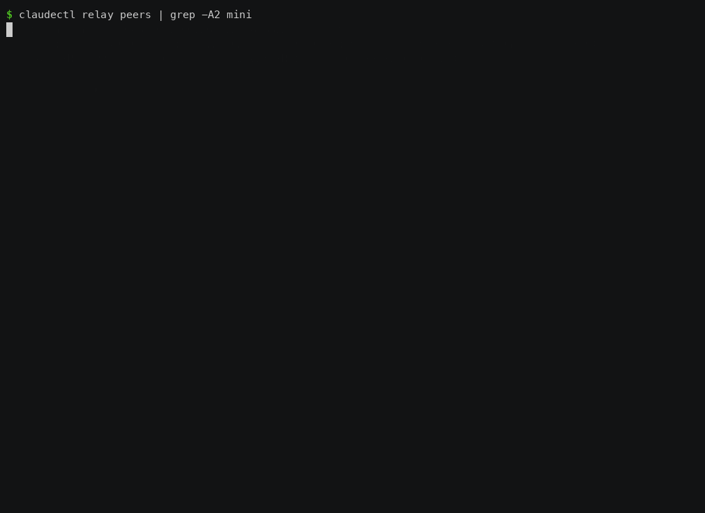

# Fleet Supervisor

Hand claudectl a queue of tasks and it runs them on your machines unattended. Each task gets its own git worktree and branch. A task is DONE only when its verifiers pass. A task whose verifier fails goes back to work with the failure in its prompt. A task with dependencies starts after they finish, and it's told what they handed off. With two or more machines paired over the [relay](relay.md), each task goes where there's room.

{ .terminal-screenshot }

Recorded on two real Macs with real `claude`, on 0.90.0. The laptop supervises. Both tasks went to the mini, which had more free memory. `fix-it` failed its verifier on the mini, went back to the same worktree with the failure in its prompt, and passed.

```
tasks.toml ──► supervisor work ──► place ──► run (here, or on a peer) ──► verify ──► DONE
                     ▲                                                  │
                     └──────────── retry with the failure output ◄──────┘
```

## On one machine

### 1. Describe the work

```toml
# tasks.toml
[[task]]
name    = "user-schema"
cwd     = "."                      # relative to this file
prompt  = "Add a users table migration with email and created_at."
git_ref = "main"                   # run in a new worktree from main, on its own branch

  [[task.verify]]
  run = "cargo test --all-targets"   # the exit code is the verdict

[[task]]
name        = "user-api"
cwd         = "."
prompt      = "Add CRUD endpoints for users on top of the new table."
git_ref     = "main"
depends_on  = ["user-schema"]      # starts once user-schema is DONE
max_retries = 2

  [[task.verify]]
  run = "cargo test --all-targets"

  [[task.verify]]
  agent = "Review the diff for missing auth checks on the new endpoints."
  model = "haiku"                  # a read-only reviewer: it can read the work, not change it
  budget_usd = 0.25
```

### 2. Queue it and run it

```bash
claudectl supervisor validate tasks.toml   # catches typos, dangling or cyclic depends_on
claudectl supervisor run tasks.toml        # queues; doesn't run anything
claudectl supervisor work --until-idle     # runs the queue, then exits when nothing is left
```

`supervisor work` is the whole loop: start a `claude` session per task, watch it, run its verifiers, retry or finish. It touches no session it didn't start. Leave it running without `--until-idle`, or run it under your service manager, for a queue that keeps filling.

### 3. Watch it

```bash
claudectl supervisor status            # one line per task
claudectl supervisor status --graph    # the depends_on tree, and why anything is blocked
claudectl supervisor logs <task_id>    # every transition and verdict
```

```
user-schema [DONE] task_…_0
  user-api [RUNNING] task_…_1
```

### What happens to a task

| It… | The supervisor… |
| --- | --- |
| ran in a worktree | made `~/.claudectl/worktrees/<task>` on `claudectl/<name>-<id>` (or your `branch =`). Your checkout is never touched. A clean worktree is removed after DONE; the branch stays. |
| passed every verifier | marks it DONE. |
| failed a verifier | sends it back to work in the same worktree, its prompt now ending with the verifier's output, up to `max_retries`, then NEEDS_HUMAN. |
| had its session die | resumes it with a prompt that says to assess the worktree before doing anything. |
| depends on a task that was cancelled or needs a human | moves it to NEEDS_HUMAN with the reason, e.g. `dependency_cancelled:user-schema`, and so on down the chain. |
| was running when `supervisor work` restarted | adopts the running session instead of starting a second one. |

Verifiers come in three kinds:
- **`run`** is a shell command in the worktree, and its exit code is the verdict.
- **`brain`** asks your local model (`[brain]` in the config), which is shown the task's diff.
- **`agent`** runs a headless, read-only `claude` reviewer in the worktree that answers PASS or FAIL.

A verifier that can't reach a verdict counts as a FAIL.

## Across machines

Pair two machines with the relay first: [Connect Two Machines](relay.md#quick-start-connect-two-machines). Then run `relay serve` on both. Each machine's relay advertises how much room it has on every heartbeat:

```bash
$ claudectl relay peers
baradas-mac-mini-508f9c0e 100.109.212.89:9910      yes
  └ claudectl 0.90.0 · claude 2.1.301, git 2.54.0, node 22.23.3 (macos/aarch64)
  └ 9874 MB free · load 0.10/core · 49690 MB disk · 0 running (1s ago)
```

From then on, `supervisor work` places each task on the machine with the most free memory that can take it, here or on a peer. On a peer, the task runs in that peer's worktree and its `run =` verifiers run there too, and the verdicts come back to the supervisor. A retry goes back to the same peer and the same worktree.

### Limits per machine: `policy.toml`

`~/.claudectl/coord/policy.toml`. Without it, this machine runs four tasks at a time, as before.

```toml
stale_after_secs = 90            # a peer heard from longer ago than this gets nothing

[local]                          # this machine
max_tasks         = 4
min_free_mem_mb   = 2048         # don't start a task below this much free memory
max_load_per_core = 1.5
min_free_disk_mb  = 5120
mem_per_task_mb   = 1024         # what a task is assumed to take until it's measured
drain             = false        # true: start nothing here (same as `supervisor drain`)

[peers]                          # defaults for every peer
max_tasks = 2

[peers.baradas-mac-mini-508f9c0e]
max_tasks = 6
```

A floor that's set and a measurement that's missing is not room: an unknown is never treated as plenty. A misspelt key is an error, and `supervisor work` won't start with a broken policy.

Each machine also advertises its own `[local] max_tasks`, and a peer refuses work past it. A refusal doesn't use up a retry; the task is simply placed again.

A machine that refused a task, or couldn't be sent it, isn't tried for that task again straight away:
- **It backs off:** 5 s after one refusal in a row, then 10, 20, 40, 80, 160, and at most 5 minutes.
- **Another machine can take it meanwhile.** If none can, the task waits and says why.
- **After 10 attempts in a row that never started** (about 20 minutes), the task goes to NEEDS_HUMAN with the peer's own reason, for example `never_started: 10 attempts in a row didn't start; the last was peer_refused on baradas-mac-mini-508f9c0e: Could not start the task: spawn claude …: No such file or directory`.
- **An attempt that actually ran starts the count again.**

### Choosing where a task runs

```toml
requires = ["docker", "node>=22", "claude:auth"]   # tags, or tools the relay probes
peer     = "baradas-mac-mini-508f9c0e"            # only there
```

- **Tags** are yours to define: `[relay] tags = ["docker", "gpu"]` in a machine's config.
- **Tools** are probed by the relay: `claude`, `git`, `cargo`, `python3`, `node`, with `>=` for a version and `:auth` for a credential.
- A name that's neither a tag nor a probed tool is never met.

These tasks stay on the machine that submitted them:
- **A task with a `role`**, because the mailbox is local.
- **A task with a `brain =` or `agent =` verifier**, because those verifiers run locally.

### When a task waits, it says why

`supervisor work` prints a waiting task's reason when it changes, not every pass:

```
waiting: task_…_3: this machine is running 4 of 4 tasks; baradas-mac-mini-508f9c0e lacks `docker`
waiting: task_…_5: this machine is draining; baradas-mac-mini-508f9c0e has not been heard from recently
waiting: task_…_7: this machine is draining; baradas-mac-mini-508f9c0e didn't start the last 3 attempt(s) (peer_refused); backing off 20s
```

### Rules for running on a peer

- **The repo lives at the same path on both machines.** A task's `cwd` is used on the peer as-is. If it doesn't exist there, that attempt fails with "working directory does not exist on this host".
- **The work comes back as a branch on the peer.** The handoff names it (`claudectl/<name>-<id>`). Fetch it the way you'd fetch any branch from that machine, for example over ssh.
- **A peer never runs two attempts of one task at once.** If the supervising machine stops hearing about an attempt (its relay was down, say), it asks the peer to stop that attempt before sending the task again. The peer also refuses a second attempt while the first is still running.
- **Both machines need `relay serve` running**, on builds that agree the `supervised-task` feature (each `relay serve` logs the features a link agreed). The supervisor won't send a supervised task to an older peer, which would skip the verifiers.

## Worked example: two Macs

The run used to verify this release had a laptop supervising, drained so it ran nothing itself, and a Mac mini peer, with the repo at `/tmp/claudectl-cluster/repo` on both:

- **An unpinned task.** Placement chose the mini on its own. `claude` committed `MINI.txt` on `claudectl/cluster-auto-…` in the mini's worktree, the verifier passed on the mini, and the task was DONE. $0.32.
- **A task pinned to the mini and written to fail once.**
  - Attempt 1 wrote `draft`. The verifier failed on the mini, and its output (`FIX.txt must contain exactly the word final`) came back to the laptop.
  - Attempt 2 went back to the same peer and worktree with that output in its prompt, wrote `final`, passed, and was DONE. $0.33 + $0.35.
- **Afterwards:** the mini's checkout was untouched, and both branches held their commits.

## Known gaps

- The handoff carries the branch and a summary, not a PR link.
- `brain =` and `agent =` verifiers run only on the supervising machine, so tasks that use them aren't sent to peers.

See also: [Reference: supervisor commands](reference.md), [Relay & Hive Mind](relay.md).
